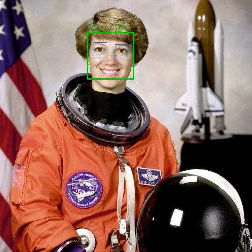

# Face Detection & Recognition System — Python & MATLAB


A desktop application that **enrolls people from the camera**, **recognizes several faces at once**
and **keeps a time-stamped record** of who appeared in front of the camera, plus small stand-alone
face detectors for scripts.

<p align="center"></p>

## Features
| | Python (`python/face_app.py`) | MATLAB (`matlab/face_app.m`) |
|---|---|---|
| Add person from camera (auto-captures 12–15 samples) | ✔ | ✔ |
| Add person from photos | ✔ | ✔ |
| Live recognition, every face labelled with name + ID | ✔ | ✔ |
| Recognize faces in a photo | ✔ | ✔ |
| People list with photo, ID (P001, P002…), rename, remove | ✔ | ✔ |
| Sighting log: *“Name (P001), 31 Ekim 2026 Cumartesi, saat 15:42:10'de kamerada görüldü.”* | ✔ | ✔ |
| Delete selected / all records, export to CSV / Excel | ✔ | ✔ |
| Detector | YuNet (CNN) | Viola-Jones |
| Recognizer | SFace 128-d embedding, cosine ≥ 0.363 | HOG + LBP, nearest neighbour |

A person is logged at most once per minute (`LOG_COOLDOWN_S` / `COOLDOWN`).

## Quick start
### Python
```bash
cd python
pip install -r requirements.txt
python face_app.py                  # GUI (models are downloaded on first run, ~40 MB)
python face_detect.py --image ../examples/astronaut.jpg          # detection only (Haar)
python face_detect.py --image group.jpg --method dnn             # detection only (ResNet-SSD)
python face_detect.py --webcam
```
### MATLAB
```matlab
cd matlab
face_app          % GUI
face_detect       % detection on the example image
```
Camera functions in MATLAB need the free **MATLAB Support Package for USB Webcams** (Home → Add-Ons).
Toolboxes: Computer Vision, Image Processing.

## Privacy
Face images, embeddings and sighting records are stored **only on the local machine** in
`python/database/` and `matlab/database/`; both folders are excluded from Git. Removed people are
moved to `database/faces/_removed/` rather than erased. Inform people and obtain consent before
enrolling them; biometric data is personal data under KVKK/GDPR.

## Limitations
- The MATLAB recognizer uses hand-crafted features; it is less robust to pose and lighting than the
  Python SFace model. Enroll each person under the lighting where the camera is used.
- The thresholds are general defaults; tune them on your own people and camera.
- The example image `examples/astronaut.jpg` is the public-domain NASA portrait shipped with scikit-image.

## Türkçe
Kamera ile kişi kaydı, aynı anda birden fazla yüzü isim ve numarayla tanıma, “şu kişi şu tarih ve saatte
kamerada görüldü” kayıtları (silme ve Excel'e aktarma dahil). Yüz verileri yalnızca bilgisayarda tutulur,
GitHub'a gönderilmez.

## Citation
See [`CITATION.cff`](CITATION.cff) or use GitHub's “Cite this repository” button.

**Author:** Asst. Prof. Dr. Olcay Palta, Bitlis Eren University · [ORCID 0000-0002-7496-2101](https://orcid.org/0000-0002-7496-2101)
